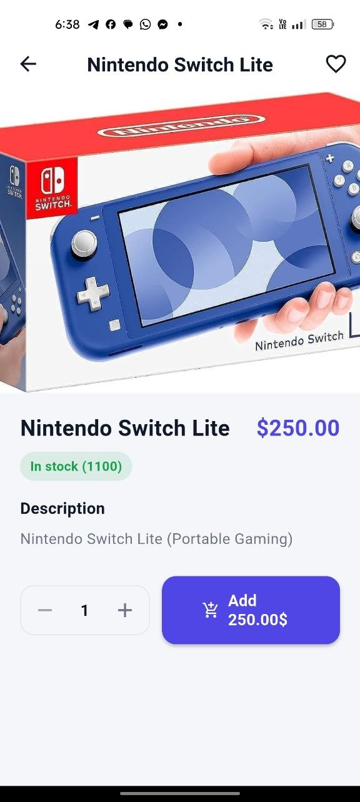
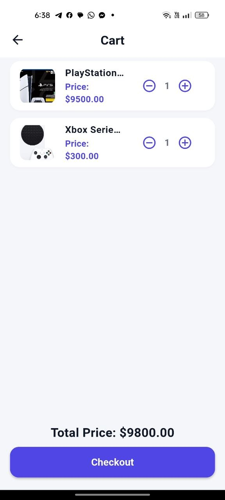
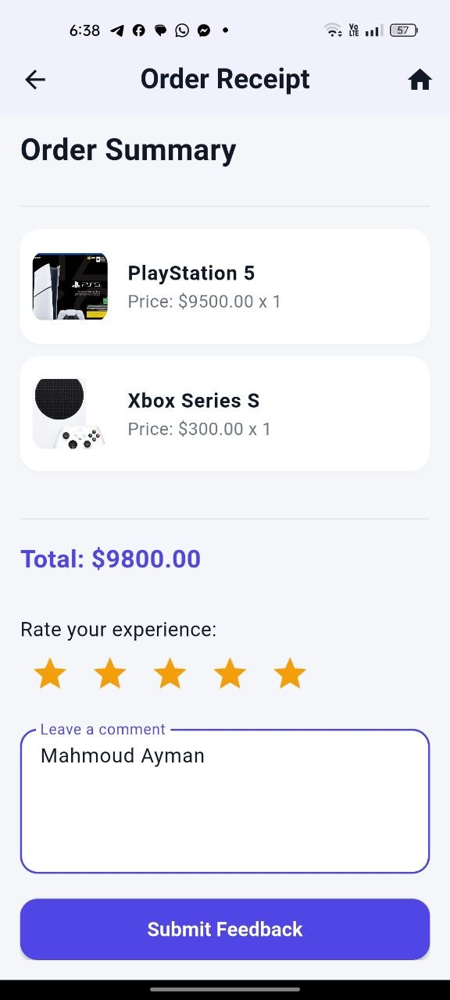
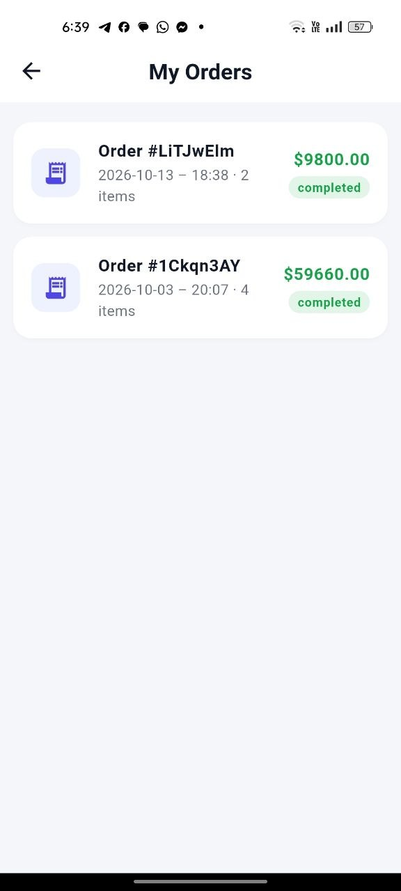
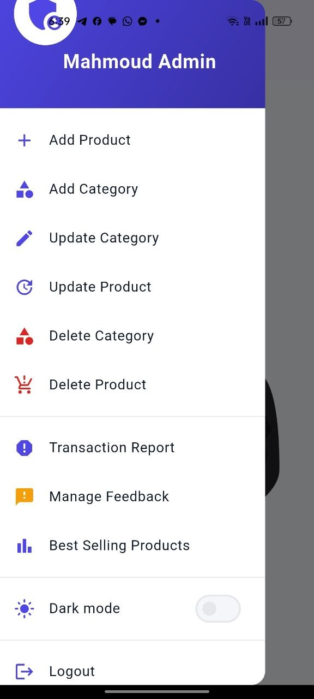

# Online Store — Flutter + Firebase

A full e-commerce app: role-based auth (user/admin), categories & products CRUD,
cart, atomic checkout, order receipts, feedback, transaction reports, and a
best-selling chart — with global search, wishlist, order history, and dark mode.

> Status: college project hardened toward production. See `PROJECT_REPORT.md`
> for the security/architecture audit and roadmap.

## Features

**Buyer**
- Email/password signup with verification, login, password reset, remember-me (email only — never stores passwords)
- Splash + one-time onboarding
- Browse categories → products, text search + global search across all products
- Product details (description, stock, quantity stepper), wishlist, cart
- Atomic checkout (server-verified prices), order receipt, order history
- Rate the order + comment (feedback linked to order)
- Light / dark mode

**Admin**
- Guarded admin panel (UI guard + Firestore rules enforcement)
- Add / update / delete products & categories
- Transaction report by date (buyer name + email), customer feedback browser (newest first), best-selling pie + ranked table

**Security (already applied)**
- `firestore.rules` + `storage.rules`: public product read, admin-only writes,
  users read/write own docs only, `role` immutable by client, transactions append-only
  with anti-spam caps, storage client writes denied (app uses URL strings)
- Atomic checkout via `runTransaction`: server-verified prices, stock decrement,
  `soldCount` increment, cart clear — all-or-nothing (+ Cloud Function ready)
- No plaintext credentials, email verification enforced, strong-password + phone validators

## Tech stack

Flutter (Material 3) · Firebase Auth · Cloud Firestore · Cloud Functions ·
`cached_network_image` · `fl_chart` · `shared_preferences` · `intl`

Dependency highlights: `cloud_functions` (server checkout), `fl_chart` (analytics),
`cached_network_image`, `shared_preferences` (prefs + theme mode + onboarding flag).

## Getting started

### 1. Prerequisites
- Flutter SDK 3.47+ (see `pubspec.yaml` for Dart constraint)
- A Firebase project with Auth (Email/Password) + Firestore enabled

### 2. Install
```bash
flutter pub get
```

### 3. Configure Firebase
```bash
dart pub global activate flutterfire_cli
flutterfire configure   # regenerates lib/firebase_options.dart
```

### 4. Deploy security rules + functions
```bash
firebase deploy --only firestore:rules,storage
cd functions && npm install && cd ..
firebase deploy --only functions
```

### 5. Bootstrap first admin
```bash
firebase functions:secrets:set SETUP_SECRET
# then call bootstrapFirstAdmin({secret, uid}) once,
# afterwards manage admins via setAdminRole (caller must be admin)
```

### 6. Seed roles (transitional)
- Register a user from the app, then in Firestore Console set
  `Users Collection/<uid>.role = "admin"` for your admin account.
  (Client code can never escalate roles — rules reject `role` changes.)
- Enable Email verification templates in Firebase Console → Auth.

### 7. Run
```bash
flutter run
```

## Testing

Pure business logic lives in `lib/core/validators.dart` (no Firebase) so it
runs without mocks:

```bash
flutter test
```

- `test/validators_test.dart` — email / password / phone / role rules
- `test/cart_total_test.dart` — cart total math + negative rejection
- `test/widget_test.dart` — smoke test (full Firebase flows need
  `firebase_auth_mocks` / `fake_cloud_firestore` — planned)

## Project structure

```
lib/
  core/           # theme, responsive, validators, ui states, checkout_service
  data/           # models, repositories, cart_service
  screen/         # auth, home, products, details, cart, orders, wishlist,
                  # receipt, profile, admin + CRUD, transactions, feedback, charts
  main.dart       # Firebase init + theme mode
  firebase_options.dart  # generated (do not hand-edit)
functions/        # checkout + setAdminRole + bootstrapFirstAdmin
firestore.rules / storage.rules
test/             # unit + smoke tests
PROJECT_REPORT.md # audit: strengths, gaps, roadmap
APP_REPORT.md/.pdf# before/after report (Arabic) + todo list
```

## Collections (Firestore)

| Collection | Access |
|---|---|
| `Users Collection/{uid}` | owner or admin; `role` immutable by client |
| `Users Collection/{uid}/Cart/*` | owner only |
| `Users Collection/{uid}/Wishlist/*` | owner only |
| `Categories`, `products` | read public, write admin only |
| `Transactions` | create signed-in (caps: ≤50 items, ≤500k total), read owner/admin, no edit |
| `Feedbacks` | create signed-in (rating 1-5, comment ≤1000), read owner/admin |

> Note: `Users Collection` keeps its legacy name with a space. A future
> migration should rename to `users` (lowercase, no spaces) with a data migration.

## Roadmap to production

- [x] Cloud Function `checkout()` + Custom Claims groundwork
- [x] Repositories, pagination, shared cart service
- [ ] App Check + rate limiting (abuse protection)
- [ ] Riverpod/Bloc state management, offline cache
- [ ] Payments, order tracking + statuses, FCM push, analytics
- [ ] CI (`analyze` + `test` + release build), flavors (dev/prod), golden tests

## Screenshots

| Login | Home | Products |
|---|---|---|
|  |  |  |

| Details | Cart | Receipt |
|---|---|---|
|  |  |  |

| Orders | Admin |
|---|---|
|  |  |
